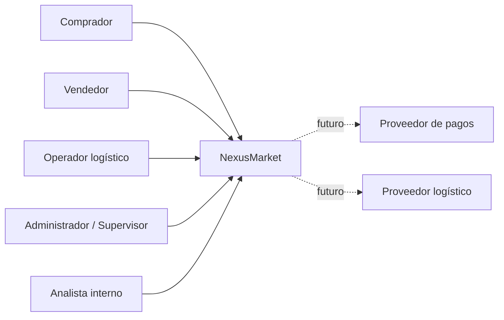
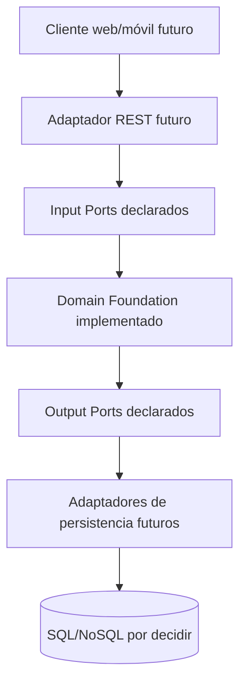
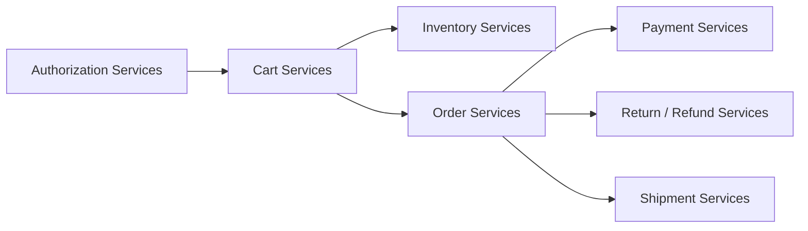

# C4 — vista conceptual

Los diagramas siguientes describen la arquitectura objetivo y distinguen claramente componentes implementados de componentes pendientes.

## Nivel 1 — Contexto

## Nivel 2 — Contenedores lógicos

## Nivel 3 — Dominio

## Nota de estado

REST, persistencia, autenticación y casos de uso se dibujan como futuros, no como código ya implementado. El diagrama debe actualizarse cuando se añadan esos componentes.
