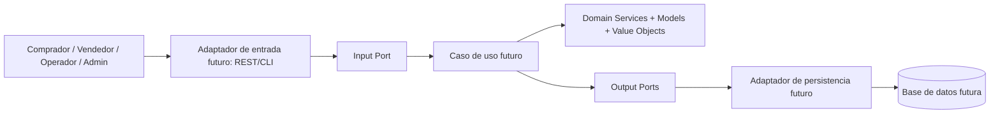

# Arquitectura de software

## Estilo

NexusMarket sigue una arquitectura hexagonal con separación DDD. La dependencia de código apunta hacia el dominio; el dominio no conoce frameworks, transporte HTTP ni almacenamiento.

## Capas

1. **Domain models:** identidad, estado y comportamiento del negocio.
2. **Value Objects:** valores validados y conjuntos acotados.
3. **Domain services:** reglas que involucran varios objetos o que representan validaciones de dominio.
4. **Input ports:** contratos de las operaciones ofrecidas a los actores.
5. **Output ports:** contratos de consultas/guardado que requieren información externa al dominio.
6. **Use-case adapters (pendientes):** coordinan puertos de entrada, servicios, puertos de salida y transacciones.
7. **REST/persistence adapters (pendientes):** convierten HTTP y persistencia a contratos de aplicación/dominio.

## Reglas de dependencia

- `application.domain` no puede importar Spring, Jakarta Persistence, JDBC, MongoDB, DTO HTTP ni repositorios concretos.
- Los adaptadores implementan los `ports/out`; no se colocan implementaciones de SQL en servicios de dominio.
- Validar duplicados antes de persistir no sustituye constraints únicos, transacciones ni idempotencia del adaptador.
- No se debe confiar en un rol recibido del cliente: cuando exista autenticación, se resolverá desde la identidad autenticada y el estado actual del usuario.

## Decisiones no implementadas aún

No se seleccionó proveedor SQL/NoSQL, framework REST ni estrategia de autenticación porque el ZIP actual corresponde a Domain Foundation y la entrega siguiente no fue adjuntada. Si el profesor exige estos componentes, deberán añadirse en una fase posterior.
