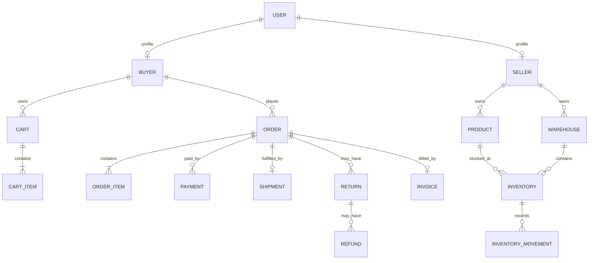

# Modelo de dominio

Este documento describe las clases reales en `src/main/java/application/domain/models`. Los campos de relaciones expresados como `String ...Id` son identificadores de otras entidades; los casos de uso deben resolver y validar los objetos autoritativos antes de ejecutar reglas.

## Entidades

| Clase | Identidad / atributos | Responsabilidad y reglas |
|---|---|---|
| `User` | `id`, `name`, `Email email`, `UserStatus status`, `UserRole role` | Identidad de acceso. El correo debe normalizarse y ser único en persistencia; un usuario tiene un rol. `ValidateUserAuthorizationService` exige estado ACTIVE y rol presente. |
| `Buyer` | `id`, `userId`, `BuyerStatus status`, `ContactInformation contactInformation` | Perfil comercial vinculado a un usuario. El acceso exige que `Buyer.userId == User.id` y que el perfil esté activo. |
| `Seller` | `id`, `userId`, `name`, `SellerStatus status` | Perfil vendedor. El usuario asociado debe coincidir y el vendedor debe estar ACTIVE para administrar recursos. El alta debe autorizarse solo al administrador. |
| `Product` | `id`, `sellerId`, `ProductType type`, `name`, `description`, `ProductPrice price`, `ProductStatus status` | Producto de catálogo propiedad de un vendedor. El tipo distingue físico/digital. El constructor legado asume PHYSICAL; usar el constructor con tipo explícito. |
| `Warehouse` | `id`, `sellerId`, `name`, `WarehouseStatus status` | Almacén propiedad del vendedor. Solo almacenes activos deben participar en operaciones de inventario. |
| `Inventory` | `id`, `productId`, `warehouseId`, `InventoryQuantity quantity` | Existencias por producto y almacén. Available y reserved no pueden ser negativas. Las actualizaciones concurrentes deben ser atómicas en persistencia. |
| `InventoryReservation` | `id`, `inventoryId`, `orderId`, `Quantity quantity`, `ReservationStatus status` | Reserva identificable asociada a pedido; permite liberar/consumir una vez. La actualización de reserva e inventario debe ser atómica. |
| `InventoryMovement` | `id`, `inventoryId`, `MovementType type`, `Quantity quantity`, `referenceId`, `occurredAt` | Registro inmutable de inflow, reservation, sale, adjustment o return. Debe persistirse como historial append-only. |
| `Cart` | `id`, `buyerId`, `items`, `CartStatus status` | Carrito del comprador. Solo ACTIVE se puede modificar/checkout; checkout requiere artículos. |
| `CartItem` | `productId`, `Quantity quantity`, `ProductPrice unitPrice` | Línea de carrito con precio unitario capturado y subtotal derivado. Cantidad de una línea comprada debe ser > 0. |
| `Order` | `id`, `buyerId`, `items`, `OrderTotal total`, `OrderStatus status`, `paymentId`, `shipmentId` | Pedido con importe/estado. Sus transiciones son controladas por `ValidateOrderStatusTransitionService`; pedidos finales no deben reabrirse. |
| `OrderItem` | `productId`, `Quantity quantity`, `ProductPrice unitPrice` | Línea inmutable del pedido; conservar el precio acordado en el momento de la compra. |
| `Payment` | `id`, `orderId`, `Money amount`, `PaymentStatus status`, `processedAt` | Pago asociado a un pedido. Importe y moneda deben coincidir con el total del pedido para un pago total. |
| `Invoice` | `id`, `orderId`, `number`, `Money total`, `issuedAt` | Factura asociada a un pedido; su número debe ser único en persistencia. |
| `Shipment` | `id`, `orderId`, `ShipmentStatus status`, `TrackingCode trackingCode`, `Address deliveryInformation` | Envío asociado a pedido y ciclo de estados logísticos. Para productos digitales la aplicación puede omitir envío físico. |
| `Return` | `id`, `orderId`, `reason`, `ReturnStatus status`, `requestedAt` | Solicitud de devolución asociada a pedido. La transición y elegibilidad se validan antes de cambiar estado. |
| `Refund` | `id`, `returnId`, `Money amount`, `RefundStatus status`, `processedAt` | Reembolso asociado a una devolución. Se valida el historial previo antes de procesar. |
| `Operation` | `id`, `userId`, `OperationType operationType`, `resourceId`, `timestamp` | Registro de una operación de negocio. |
| `AuditLog` | `id`, `operationId`, `userId`, `UserRole role`, `resourceId`, `timestamp`, `details`, `AuditSeverity severity` | Traza de auditoría; los registros críticos deben ser append-only. |

## Relaciones

La cardinalidad de reembolsos en el diagrama representa la relación técnica y el historial; la política de negocio implementada en esta etapa permite como máximo un reembolso PENDING o PROCESSED por devolución. Un reembolso REJECTED permite crear un nuevo intento.

## Invariantes transversales

- Los identificadores de entidad y relaciones obligatorias no pueden estar vacíos.
- No se permite inventario negativo.
- La cantidad de una operación de reserva/liberación/movimiento debe ser positiva.
- Un usuario debe estar activo y tener rol para operaciones protegidas.
- El usuario solo puede operar sobre el perfil que referencia su `userId`.
- Un vendedor solo opera sobre productos/almacenes cuyo `sellerId` coincide con su perfil.
- Un pago debe corresponder al pedido y coincidir en importe y moneda para pago total.
- Una devolución y su reembolso deben corresponder al pedido/devolución correctos.
- La persistencia debe garantizar unicidad e integridad referencial; las validaciones de dominio no sustituyen constraints.
